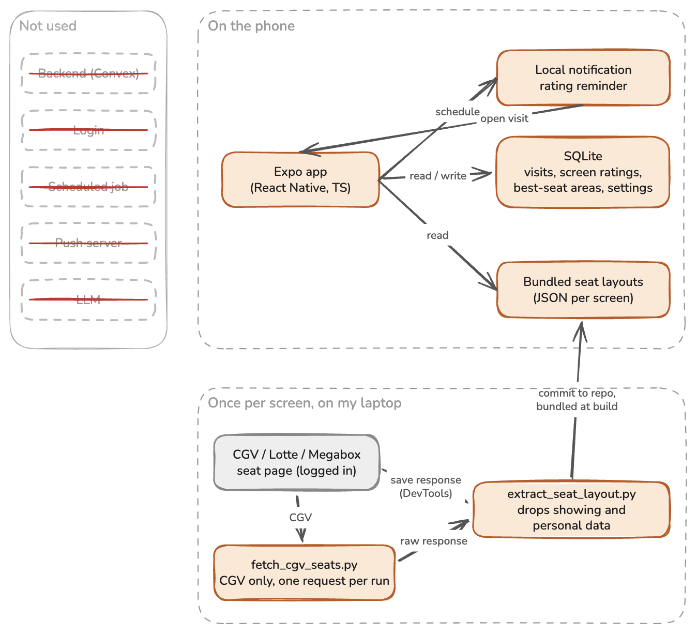

# G열 8번: System design

## Overview

G열 8번 runs only on the phone (Shape A), with no backend.

- An Expo app (React Native, TypeScript) that opens on theater and screen search.
- SQLite on the phone for visits (looked up by screen, sorted by date), screen ratings, best-seat areas and settings.
- Bundled seat layouts: one JSON file per screen, collected once by hand.
- Local notifications reminding me to rate a booked movie after it ends.

Out of scope: rating whole theaters, user-defined rating items, the viewer's height, other people's ratings, login, detecting layout changes, and scheduled collection.

## Diagram

## Core flow

### Record a past visit (Watched)

1. Pick the theater and screen. *(bundled layouts)*
2. Pick the seat on the grid, or type the row and number if the screen has no layout. *(app)*
3. Pick the date (start time optional). *(app)*
4. Rate height and left/right position (five choices each), and tick what was uncomfortable: legroom, chair, vents, nearby light, one-sided sound, light leaking at the masking, outside noise. *(SQLite)*
5. Adjust my best-seat area for this screen, starting from the last one: tap seats, or long-press and drag. Skippable, but asked every time. *(SQLite)*
6. "Rate the screen too?": overall sound, five choices, prefilled. Skippable, with "don't ask again". *(SQLite)*

### Record a future visit (To-watch)

1. Save the theater, screen and seat. *(SQLite)*
2. Schedule a reminder 3 hours after the start time, or at 8:00 the next morning without one. *(local notification)*
3. The reminder opens the visit. Finishing steps 4 to 6 moves it to Watched. *(app, SQLite)*

### Before booking

1. Find a theater and screen. *(bundled layouts)*
2. The grid marks the seats I sat in and my best-seat area. Tapping a past seat shows that visit's ratings; a button shows the screen rating. *(SQLite)*

## Data

| Table | Where | Fields | Unique by |
|---|---|---|---|
| `screens` | bundled JSON | chain, site, screen, names, grid size, entrances | chain + site no + screen no |
| `seats` | bundled JSON | row, number, x, y, zone, kind, aisles | screen + row + number |
| `visits` | SQLite | seat, date, start time, status, height, side, discomforts | its own id |
| `screen_ratings` | SQLite | screen, sound, updated at | screen |
| `best_seat_areas` | SQLite | screen, seat list, saved at | screen + saved time |
| `settings` | SQLite | name, value | setting name |

Records are searched and sorted, so SQLite rather than AsyncStorage. Nothing is secret, so no SecureStore.

## Data sources

All three chains require login for the seat page, so I save each screen's seat response once with my own account: from DevTools, or for CGV with `scripts/fetch_cgv_seats.py` (one request per manual run).

| Chain | Response | Notes |
|---|---|---|
| CGV | `searchIfSeatData` | grid coordinates, zones, aisle flags |
| Lotte Cinema | `TicketingData.aspx` (`GetSeats`) | pixel coordinates, no theater or screen name |
| Megabox | seat list with `seatListSD01` | grid coordinates, seat classes, last-updated dates |

`scripts/extract_seat_layout.py` converts all three into one format and drops anything tied to a showing or a person: sale status, other customers' booking numbers, staff ids. Drawn as text with `render_layout.py`, all three match the sites' seat maps.

Collected so far (layout; raw response, ids redacted):

- CGV 용산 IMAX관, 624 seats: [layout](samples/cgv-yongsan-imax-layout.json), [raw](samples/raw/cgv-yongsan-imax-response.json)
- 롯데시네마 신림 1관, 188 seats: [layout](samples/lotte-sillim-100701-layout.json), [raw](samples/raw/lotte-sillim-100701-response.json)
- 메가박스 강남 르 리클라이너 6관, 56 seats: [layout](samples/megabox-gangnam-6-layout.json), [raw](samples/raw/megabox-gangnam-6-response.json)

Each screen is collected once, and again after a renovation. If collection fails, I type the row and number instead (Core flow step 2).

Limits: only collected screens are covered, and login tokens expire. Lotte and Megabox have no aisle flags, so an empty neighboring cell counts as an aisle.

## Decisions

### 1. Phone only, no backend

- Context: no data is shared between users, and seat layouts rarely change.
- Decision: everything stays on the phone; layouts ship in the app.
- Consequences: no server to run or protect. Losing the phone loses the records, and adding a screen needs an app update.
- Not picked: a Convex backend, for layout updates without a release, backups, or others' ratings. But others' ratings pull toward one shared best seat, and the best seat differs by person.

### 2. One best-seat area per screen, updated on each visit

- Decision: each screen has one area. Every visit starts from the last one and can narrow, widen or move it.
- Consequences: the current area is the best seat, so no merging logic. Past areas are kept but not shown.
- Not picked: a new area per visit, merged later: more input, and overlapping areas are hard to show.

### 3. Reminder 3 hours after the start time

- Decision: remind 3 hours after the optional start time, or at 8:00 the next morning without one.
- Consequences: one optional field. Long or short movies get the reminder late or early.
- Not picked: typing the end time (another field on a form people already put off), or fetching it from showtimes (needs a backend, since end times come per showing).
