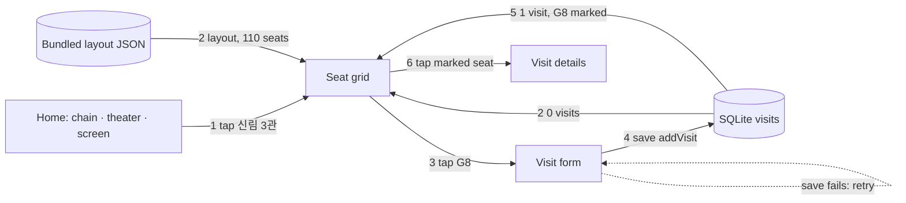
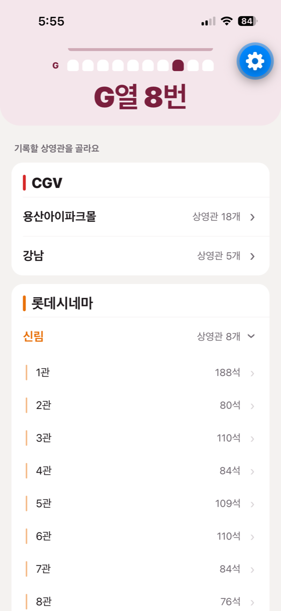
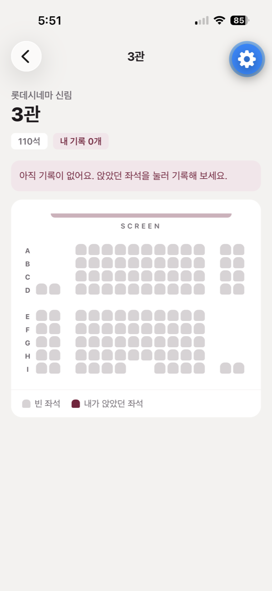
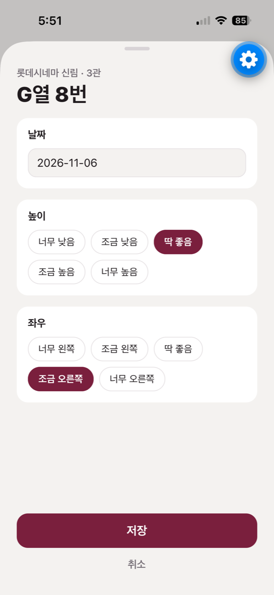
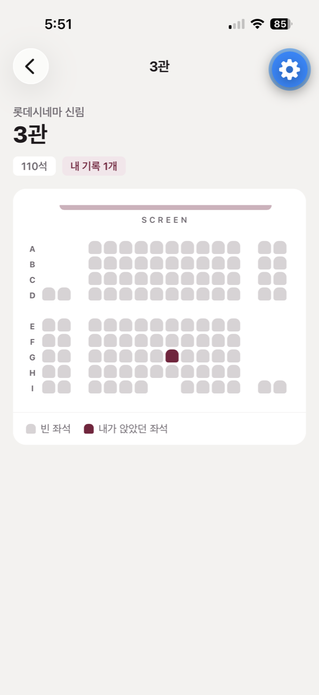
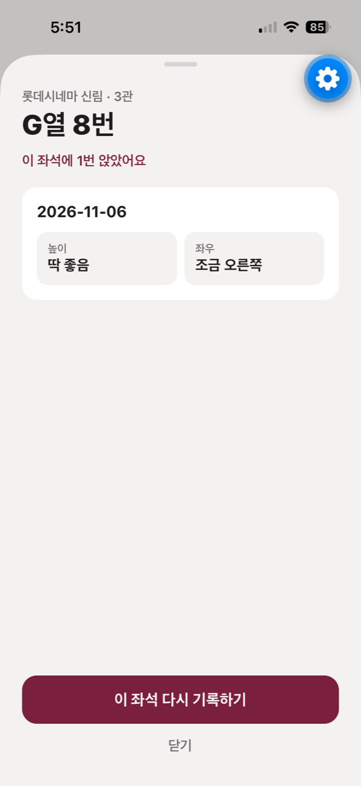
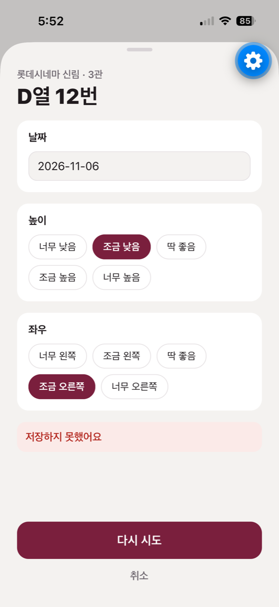

# First slice

## The sentence

When I tap G8 on the 롯데시네마 신림 3관 grid and save the date and my height and left/right ratings, it is saved to the `visits` table in SQLite on the phone, and it shows on the same screen's grid as a seat I sat in. Tapping that seat again shows the ratings from that visit.

## Diagram

There is no server. Layouts ship inside the app (49 screens in six Seoul theaters, collected with `scripts/fetch_layouts.py`), and visits stay in SQLite on the phone. The flow, walked through with this example: [artifact](https://claude.ai/artifact/G7HFrS1Cj5NAsb9GJ2S1S8).

## Screenshots

| 1 Pick a screen | 2 No visits yet | 3 Rate the seat |
|---|---|---|
|  |  |  |

| 4–5 Saved and marked | 6 See the ratings | Error: save failed |
|---|---|---|
|  |  |  |

The error screen was made with a "fail the next save" switch that only exists in development builds. The date and ratings stay as entered, and the button changes to 다시 시도 (try again).

## Tests

`npm test` runs eight tests, also in CI. Three save and read visits against a real SQLite database. Five render the grid screen and check the empty state, a marked seat, saving, a failed save, and seeing a visit's ratings.
