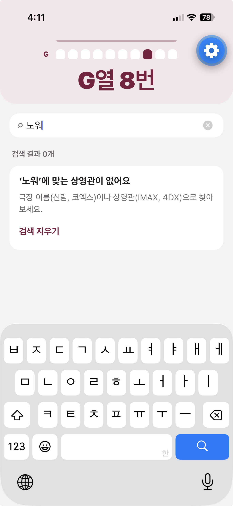
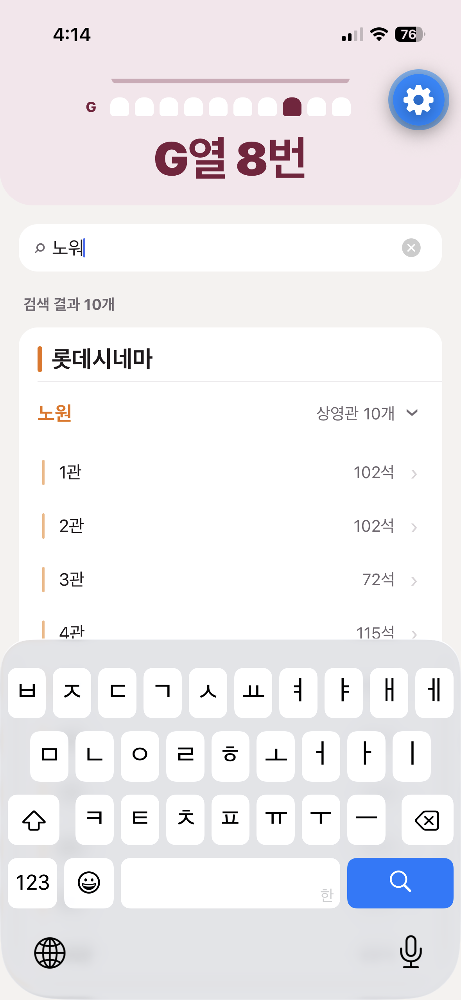
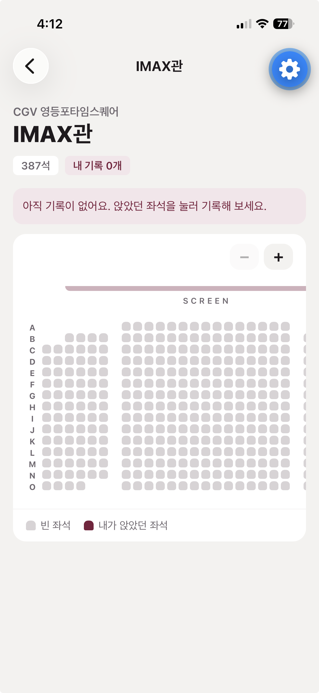
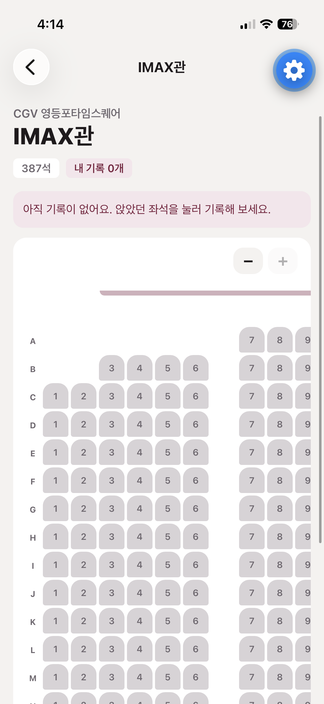
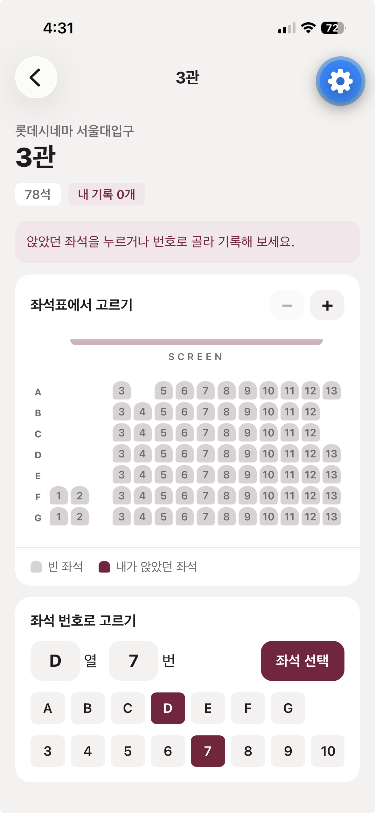
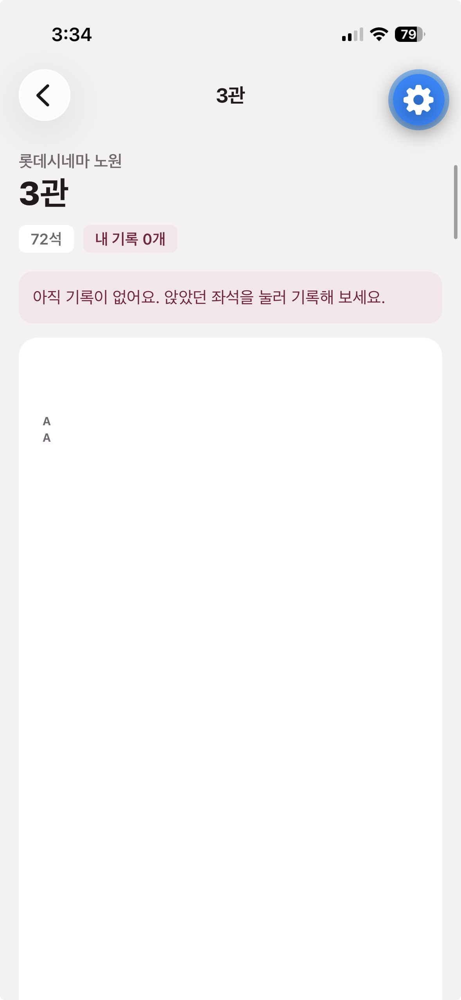
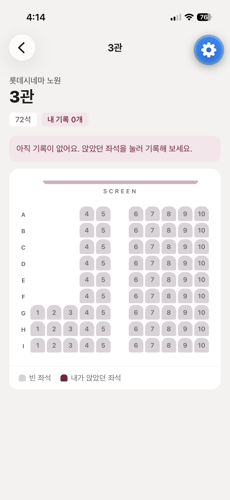

# Ship to testers

## Who tried it

| | How often they go to the movies | Device |
|---|---|---|
| Friend A | About three times a month | My iPhone (Expo Go) |
| Friend B | About once a month | My iPhone (Expo Go) |

**Task:** "Record the seat from a movie you saw recently." I asked them to do it the way they would after a real visit.

## What I saw

Both testers got stuck in the same two places.

- **Search.** Both had trouble finding their theater. For example, one of them typed 노워 on the way to 노원 and got "no matching screens." Korean is typed one syllable at a time, so the last letter is still unfinished, and a plain text match missed it.
- **Small seats in big screens.** In IMAX screens, up to 624 seats at CGV 용산아이파크몰, they had trouble finding the seat on their ticket and tapping it.
- **What they asked for:** typing a seat number like "M열 N번" instead of finding it on the grid, and a short guide for first-time users.

## What I fixed

### 1. Search while typing Korean

Search now uses [korean-regexp](https://github.com/bluewings/korean-regexp). Half-typed words (노우, 노워) and initial consonants (ㄴㅇ) find 롯데시네마 노원.

| Before | After |
|---|---|
|  |  |

### 2. Zoom on the seat grid

Pinch with two fingers, or use the − / + buttons. Seat numbers appear once the seats are big enough to read.

| Before | After |
|---|---|
|  |  |

### 3. Pick a seat by number

Below the grid, pick a row and a number from the lists, or type them, then tap 좌석 선택. It opens the same form as tapping the seat. A seat that isn't in the screen shows an error.

## Found while checking on my own phone

**Broken Lotte grids.** Lotte's API gives seats in the same column x positions a few pixels apart, for example 1264 and 1281. The old code took the smallest gap as one cell, so some grids grew to thousands of cells and the seats almost disappeared. This hit 27 Lotte screens, including 신림 5관 and 6관 from last week. Positions that are close together are now grouped into one cell, and a new test checks that every one of the 180 layouts fits in a seat-sized grid.

| Before | After |
|---|---|
|  |  |

## Slices this week

- Pick the visit date from a calendar (from the A3 review)
- 15 more Seoul theaters, 20 in total with 180 screens, plus search
- Note discomforts (legroom, chair, 냉난방, exit-sign light, 소리 쏠림, 마스킹 빛샘, outside noise)
- Delete a visit
- Seat grid zoom and pick a seat by number (from testing)
